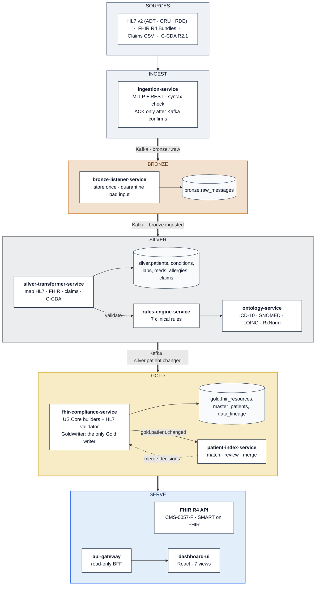
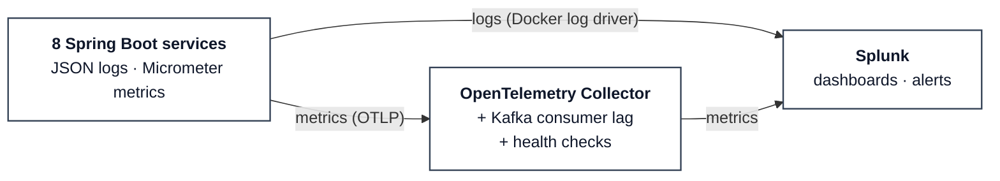

# ClinicalHarmony

**A FHIR-compliant Clinical Data Harmonization & Ontology Validation Platform.**

ClinicalHarmony takes patient data from the formats US healthcare actually exchanges —
**HL7 v2** messages, **FHIR R4** JSON, **C-CDA** documents, and **claims CSV** extracts — and
turns it into trustworthy, standards-conformant FHIR:

1. **Ingest** every payload, valid or not, into an immutable raw layer (nothing is silently dropped).
2. **Validate** every clinical code against the reference terminologies (ICD-10-CM, SNOMED CT,
   LOINC, RxNorm) and evaluate clinical plausibility rules.
3. **Conform** the data to **US Core 6.1.0** FHIR resources, checked by the official HL7 validator.
4. **Resolve** duplicate patients across source systems into a master patient index.
5. **Expose** it through payer/provider interoperability APIs (CMS-0057-F, SMART on FHIR) and a
   React dashboard covering patient timelines, ontology coverage, validation findings, raw FHIR
   and end-to-end data lineage.

**Design principle: report data-quality problems, never hide them.** Malformed input is quarantined,
not dropped; missing values are never invented; a non-compliant resource is kept and flagged with the
exact reason.

**Status:** all pipeline phases are done: eight services, event-driven on Kafka end to end, verified
by a 467-check smoke test. Now in Phase 10 (polish, demo, diagrams); see the
[build history](docs/build-history.md).

## Architecture

A Bronze → Silver → Gold **medallion** pipeline on PostgreSQL: **Bronze** keeps every payload as
received, **Silver** holds clean clinical rows and their validation findings, **Gold** holds US Core FHIR
with one master record per person. Each stage is its own Spring Boot service, and stages talk only
through Kafka topics.



Around the pipeline: **Keycloak** (OIDC sign-in for the dashboard, SMART backend-services tokens for
the FHIR API), and **Splunk + OpenTelemetry** for logs, metrics, dashboards and alerts.

**How it stays correct**

- **Transactional outbox.** Each service writes its rows and the event announcing them in one database
  transaction, so an event is never lost and never sent for a write that rolled back.
- **Idempotent consumers.** Unique keys and status checks make a redelivered event harmless, so
  delivery is at least once and a whole layer can be rebuilt by replaying its topic.
- **Dead-letter topics.** Technical failures retry with backoff, then go to `<topic>.dlt`. Bad *data* is
  never a technical failure: it is stored as quarantined or failed, with the reason.
- **One writer per layer.** Only GoldWriter writes Gold. The patient index decides merges but asks
  GoldWriter to apply them, and the gateway reads through a read-only database role.
- **Lineage and correlation ids.** Every Gold resource traces back to the raw message's SHA-256, and
  one correlation id follows a payload through every service's logs.

Topic-by-topic detail (consumer groups, partition keys, retries, log events, metrics):
[event pipeline design](docs/architecture/event-pipeline.md).

## Services

| Service | Port | What it does |
|---|---|---|
| [`ingestion-service`](ingestion-service) | 8081 · MLLP 8887 | Receives HL7 v2 (MLLP + REST), FHIR, claims CSV and C-CDA; syntax check; publishes to Kafka and acknowledges only after Kafka confirms |
| [`bronze-listener-service`](bronze-listener-service) | 8086 | Stores every payload in Bronze exactly once; quarantines what won't parse; splits claims files per line |
| [`silver-transformer-service`](silver-transformer-service) | 8087 | Maps all four formats into Silver clinical rows and has each patient validated |
| [`ontology-service`](ontology-service) | 8082 | Validates ICD-10, SNOMED CT, LOINC and RxNorm codes; SNOMED ↔ ICD-10 mapping |
| [`rules-engine-service`](rules-engine-service) | 8083 | 7 clinical plausibility rules (e.g. pregnancy on a male, drug–allergy conflict), tuned as data |
| [`fhir-compliance-service`](fhir-compliance-service) | 8084 | Builds US Core FHIR, checks it with the official HL7 validator, writes Gold with lineage; CMS-0057-F read API; C-CDA → FHIR |
| [`patient-index-service`](patient-index-service) | 8085 | Master patient index: blocking + weighted matching, auto-merge, steward review queue, unmerge |
| [`api-gateway`](api-gateway) | 8080 | Backend for the dashboard: read models over a read-only role, steward actions routed to the owning service |
| [`dashboard-ui`](dashboard-ui) | 3000 | React + TypeScript: Overview, Patient Timeline, PMI Review, Ontology Coverage, Validation Report, FHIR Viewer, Data Lineage |
| [`data-generator`](data-generator) | — | Python synthetic hospital data for every feed, with planted duplicates and defects for the demo |

Each service's README has its endpoints, design notes and tests.

### Known limitations

- **Demo scale.** Patient matching blocks in memory per run, fine for thousands of patients, not millions.
- **Offline terminology.** Codes are checked against seeded subsets, not the full licensed code systems.
- **Synthetic payer data.** The CMS-0057-F resources (Coverage, Formulary, …) are seeded; claims stay in Silver
  (no FHIR Claim / ExplanationOfBenefit yet).
- **Dev-grade security.** Keycloak runs in dev mode with secrets in the realm file and shared client
  secrets instead of `private_key_jwt`; the FHIR API supports SMART backend services only (no app launch).

More detail in the [build history](docs/build-history.md#known-limitations-in-detail).

## Standards covered

| Area | Standards |
|---|---|
| Messaging & documents | HL7 v2.5 (ADT, ORU, RDE) over MLLP · HL7 C-CDA R2.1 · claims CSV (with claim status and CARC denial reasons) |
| FHIR | FHIR R4 · US Core 6.1.0 · CMS-0057-F payer read APIs (Coverage, PractitionerRole, MedicationKnowledge, MeasureReport, Device) · Da Vinci US Drug Formulary 2.1.0 · Da Vinci DEQM 5.0.0 · SMART App Launch v2 (backend services, `system/` scopes) |
| Terminology | ICD-10-CM · SNOMED CT · LOINC · RxNorm · UCUM · CDC Race & Ethnicity (OMB) |

## Data platform

PostgreSQL 16 with a medallion layout plus a reference schema. Full DDL and seed data are in
[`docs/db-init`](docs/db-init); scripts run in order on first container start.

| Schema | Purpose | Key tables |
|---|---|---|
| `bronze` | Raw, immutable intake payloads, valid or quarantined | `raw_messages` (+ intake channel, correlation id, Kafka topic / partition / offset), `outbox_events` |
| `silver` | Parsed, typed clinical entities (before deduplication) and every validation finding | `patients`, `conditions`, `observations`, `medications`, `allergies`, `claims`, `validation_reports`, `outbox_events` |
| `gold` | Conformed, deduplicated, US Core FHIR resources with lineage — all written by one component, GoldWriter | `master_patients` (+ `match_status`), `patient_source_xref`, `master_patient_merges`, `fhir_resources` (+ `compliance_notes`), `data_lineage` (JSONB step chains), `outbox_events` |
| `pmi` | patient-index-service's working state | `match_runs`, `match_candidates` (review queue), `match_exclusions` |
| `ontology` | Reference terminology and clinical rules (rule parameters stored as JSONB) | `icd10_codes`, `snomed_codes`, `loinc_codes`, `rxnorm_codes`, `concept_mappings`, `clinical_rules` |

## Tech stack

Java 17 · Spring Boot 3.5 · Apache Camel 4.4 (MLLP) · HAPI HL7 v2 · HAPI FHIR 8.2 (validator) ·
PostgreSQL 16 (plain `JdbcTemplate`, no ORM) · Docker Compose · JUnit 5 / Mockito / Spring MVC
test slices · Testcontainers (`@SpringBootTest` integration, Postgres + Kafka) · Keycloak 26.8 + Spring Security OAuth2 resource server ·
Apache Kafka (Confluent cp-kafka 7.6.1, KRaft) + Spring for Apache Kafka 3.3 · Kafbat UI · React 19 + TypeScript · Python 3 (stdlib) data generator ·
Splunk Enterprise 10.4 + OpenTelemetry Collector 0.164 + Micrometer OTLP (observability).

## Getting started

**Prerequisites:** Docker with Docker Compose (Java 17 + Maven only to run a service outside Docker).

```bash
docker-compose up -d
```

On first start, PostgreSQL runs every script in [`docs/db-init`](docs/db-init) in order: schemas,
tables, terminology subsets, clinical rules, and Silver demo patients. To wipe everything and start over:

```bash
docker-compose down -v
```

| Component | Address |
|---|---|
| PostgreSQL | `localhost:5432` (db / user / password: `clinicalharmony`) |
| Kafka (KRaft, no Zookeeper) | `localhost:19092` (containers: `kafka:29092`) |
| Kafbat UI (Kafka console, read-only) | `localhost:8090` |
| bronze-listener-service · silver-transformer-service | `localhost:8086` · `localhost:8087` (health / metrics only) |
| ingestion-service | `localhost:8081` (REST) · `localhost:8887` (HL7 v2 MLLP) |
| ontology-service | `localhost:8082` |
| rules-engine-service | `localhost:8083` |
| fhir-compliance-service | `localhost:8084` |
| patient-index-service | `localhost:8085` |
| Keycloak (realm `clinicalharmony`) | `localhost:8180` (admin console: `admin` / `admin`, dev only) |
| api-gateway | `localhost:8080` (`/api/v1`, users `dana` / `vic`, dev only) |
| dashboard-ui | `localhost:3000` (sign in as `dana` or `vic`, dev only) |
| Splunk | `localhost:8000` web (`admin` / `clinicalharmony-splunk-dev`, dev only) · `8088` HEC · `8089` REST API |
| OpenTelemetry Collector | `localhost:4318` OTLP/HTTP · `13133` health |

### Verify the whole stack

```bash
./scripts/smoke-test.sh
```

467 black-box checks against the running stack, from intake (accept / quarantine, every format, Kafka
down → 503) through code validation, every clinical rule, US Core validation, Gold lineage, patient
matching (auto-merge, review, unmerge), the CMS-0057 API, SMART auth, the gateway and dashboard
security headers, to Splunk receiving every service's logs and each alert firing. Each service also
has unit and Testcontainers integration tests (`mvn test`) and a Postman walkthrough per phase.

## Try it

Run these from the repository root with the stack up.

```bash
# 1. Send synthetic data (HL7 over MLLP; FHIR, claims and C-CDA over REST), with planted duplicates and defects
python3 data-generator/generate.py --seed 2611

# 2. Ingest one payload yourself: 202 = accepted, 422 = kept but quarantined, 503 = Kafka down, retry
curl -i -X POST http://localhost:8081/api/ingestion/hl7 -H "Content-Type: text/plain" \
  --data-binary $'MSH|^~\\&|REG_SYSTEM|CITY_HOSPITAL|CLINICALHARMONY|INGESTION|20260703101500||ADT^A01^ADT_A01|MSG00001|P|2.5\rPID|1||MRN100234^^^CITY_HOSPITAL^MR||DOE^JANE^A||19800515|F\r'

# 3. Validate a FHIR resource against US Core 6.1.0 (each violation: FHIRPath location + suggested fix)
curl -s -X POST http://localhost:8084/api/fhir/validate -H "Content-Type: application/json" \
  -d '{"resourceType":"Patient","name":[{"family":""}]}'
```

Then open the dashboard at <http://localhost:3000> and sign in as `dana` / `dana-dev-password` (data
steward) or `vic` / `vic-dev-password` (viewer); both are dev-only users. Follow a patient from
**Patient Timeline** back to the raw message in **Data Lineage**, review duplicates in **PMI Review**, and
open a trace in Splunk at <http://localhost:8000>.

More examples (each intake format, terminology lookups, clinical rules, SMART tokens, C-CDA → FHIR,
the CMS-0057 API, patient matching, the gateway API) are in [docs/try-it.md](docs/try-it.md).

## Observability



- **Logs.** Every service writes the same structured JSON (service, event, correlation id, the record ids it
  touched, duration). Docker's Splunk log driver ships each line to Splunk, so one search follows a payload
  through every service.
- **Metrics.** Services export Micrometer metrics over OTLP to the **OpenTelemetry Collector**, which also reads
  Kafka consumer lag and polls every service's health. The services stay vendor-neutral: sending to Datadog or
  Grafana instead is a collector config change.
- **Dashboards.** *Pipeline* (throughput by layer, consumer lag, dead letters, quarantine rate, intake → Gold
  latency, service health) and *Trace by correlation id* (every log line for one payload, in order). The
  dashboard UI links to the trace for any Bronze message.
- **Alerts.** Consumer lag high, any dead letter, service down; the smoke test makes each one fire.
- **Config as code** in [`observability/`](observability). Splunk runs on its 60-day trial license (alerts
  stop working after it expires). The image is amd64-only: on Apple Silicon turn on Rosetta in Docker
  Desktop and give Docker ~12 GB.

## Design diagrams

Being drawn in draw.io; the list and conventions are in [docs/diagrams](docs/diagrams/README.md).

## Project structure

```
ClinicalHarmony/
├── docker-compose.yml
├── scripts/
│   ├── smoke-test.sh           # Black-box test of every live endpoint
│   └── fixtures/               # HL7 / FHIR / CSV / C-CDA test payloads
├── ingestion-service/          # Spring Boot + Apache Camel (MLLP) + HAPI HL7 v2
├── ontology-service/           # Terminology validators + concept mapping
├── rules-engine-service/       # Clinical rules engine
├── fhir-compliance-service/    # HAPI FHIR validator, US Core builders, C-CDA → FHIR, GoldWriter, CMS-0057 API, SMART auth
├── keycloak/                   # Realm import: clients, SMART scopes, audience mappers, dashboard roles + dev users
├── patient-index-service/      # Master patient index: matching, review queue, merge/unmerge via GoldWriter
├── api-gateway/                # Dashboard BFF: /api/v1 read models + proxied actions
├── dashboard-ui/               # React + TypeScript dashboard (Vite, nginx)
├── bronze-listener-service/    # Kafka → bronze.raw_messages (+ outbox → bronze.ingested)
├── silver-transformer-service/ # bronze.ingested → silver.* + validation (+ outbox → silver.patient.changed)
├── data-generator/             # Python synthetic data for every feed (HL7, FHIR, claims, C-CDA)
├── observability/              # Splunk app (dashboards, alerts) + OpenTelemetry Collector config
└── docs/                       # db-init SQL, architecture detail, build history, diagrams
```
